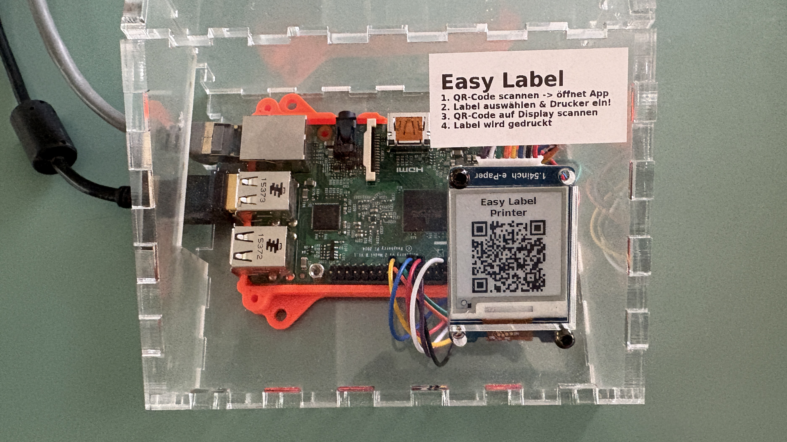

Maker Media GmbH

***

# Netzwerk-Etikettendrucker

**Dieser Etikettendrucker für die offene Werkstatt braucht weder App noch Login. Man füllt einfach ein Webformular am Handy aus und holt sein Etikett am Gerät ab. Ein E-Paper-Display mit wechselndem QR-Code stellt dabei sicher, dass Aufträge nur am Gerät ausgelöst werden können.**

Hier findet ihr den im Artikel erwähnten Ordner "docs", den ihr für die Web-App braucht, den Ordner "EasyLabelPrinting" und eine Vektor-Grafik, um das Gehäuse zu lasern.

Der vollständige Artikel zum Projekt steht in der **[Make-Ausgabe 6/26](https://www.heise.de/select/make/2026/6)**.
